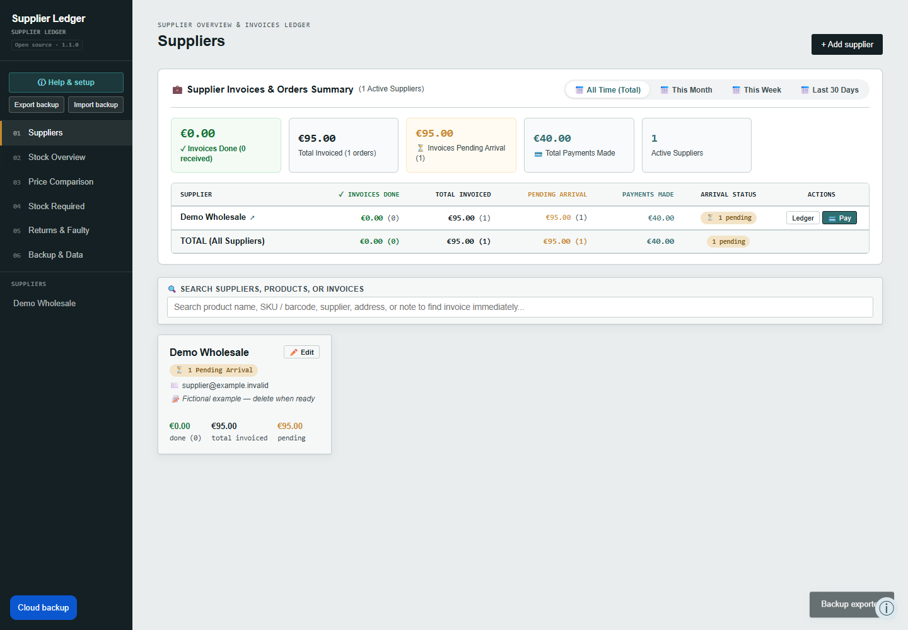

# Supplier Ledger & Stock Manager



A browser workspace for suppliers, purchase orders, deliveries, returns and stock planning. Start empty, or add fictional examples from the in-app guide.

[Live demo](https://supplier-stock-manager-demo.ranakaharian1.workers.dev/) · [Make it yours](docs/SETUP.md) · [Review and fixes](docs/REVIEW.md) · [Privacy](docs/PRIVACY.md)

## Explore

[Suppliers & payments](#suppliers--payments) | [Orders & stock](#orders--stock) | [Reports & OCR](#reports--ocr) | [Backups](#backups) | [Own hosting](docs/SETUP.md)

### Suppliers & payments

Supplier contacts, opening balances, order payments and direct payments in one workspace. A supplier's name never determines whether it has been paid. Explicit no-payment-due flags are respected. Record a payment once: the app cannot detect the same bank transfer entered both against an order and as a direct payment.

### Orders & stock

Track ordered and arrived quantities, delivery costs, returns and faulty items. Compare prices and plan required stock by category and colour. Net stock is arrived units minus returned and faulty units. This does not track retail sales, stock usage, tax accounting or automatically confirmed supplier credits.

### Reports & OCR

Download Excel and PDF reports, with a configurable business name. Import text from PDFs or recognise English invoice images, then review the draft before saving. Reporting, PDF reading and OCR libraries are pinned and served from your own installation. OCR can make mistakes; check quantities and prices against the original.

### Backups

Records are stored in this browser. JSON export/import works without an account; replacements download the current data first. The local launcher optionally keeps a folder backup and ten prior versions. Optional buyer-owned Cloudflare Workers/D1 provides **manual encrypted backups**, not live multi-user sync. GitHub contains source only; no GitHub token or business-data upload feature is included.

## Start locally

Install Node.js 22.13+ (24 recommended), then open a terminal in this folder:

```sh
npm ci
npm start
```

Open `http://127.0.0.1:8102`. Keep the terminal open and use the same browser/address. On Windows, `Start-Local.cmd` prepares missing build files and opens the app. First run downloads pinned dependencies; after building, `node local-server.cjs` needs no internet for the core app, PDF, Excel or English OCR.

The local screen password is a convenience lock. Browser data and local JSON backups are readable; keep the computer and backups private. The public demo has no cloud database and should be used with fictional records.

## Verify

```sh
npm run build
npm test
npm run test:browser
```

Browser tests require Chrome locally, or Playwright Chromium in CI. [Setup, GitHub transfer and deployment](docs/SETUP.md) covers customisation, backups and own-cloud configuration. [Review notes](docs/REVIEW.md) record the source selection and fixes; tests use fictional data and isolated stores.

## Open source

MIT; see [LICENSE](LICENSE). Third-party libraries retain their licences, copied into the built `vendor/licenses` directory. SheetJS is installed from its official versioned distribution. Owner archives, business records, Firebase configuration and credentials are excluded from this repository. Existing private owner deployments are separate.
